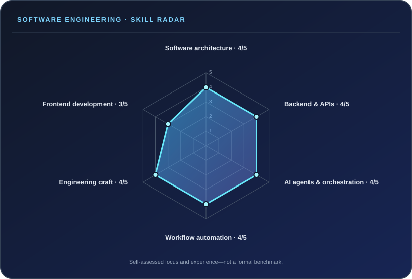

# Hi, I'm Hamza 👋

### Software architecture · AI agents · Workflow automation

I design and build software that turns complex ideas into clear, maintainable systems. My work spans **domain-driven and service-oriented architecture**, **AI agent orchestration**, and **automation platforms**—with an emphasis on practical engineering, thoughtful boundaries, and solutions people can understand and operate.

I enjoy working across the full path from problem framing and architecture to implementation, testing, and iteration. I’m particularly interested in applying agentic systems where they create real value: grounded in context, coordinated through explicit workflows, and paired with human review where it matters.

## What I focus on

- **Software architecture:** domain-driven design (DDD), bounded contexts, microservices, hexagonal architecture, and API design.
- **Agentic systems:** multi-agent workflows, orchestration, human-in-the-loop collaboration, local LLMs, and retrieval-augmented generation (RAG).
- **Workflow automation:** translating repeatable processes into observable, maintainable software.
- **Engineering craft:** clear specifications, modular design, testing, useful documentation, and iterative delivery.

## Selected work

| Project | What it explores |
| --- | --- |
| [AgentCraft](https://github.com/hamzajg/agentcraft) | A local-first, documentation-driven team of AI agents for software delivery, with orchestration, review loops, checkpoints, reusable skills, and human approval gates. |
| [StreamWeave Platform](https://github.com/hamzajg/stream-weave-platform) | An enterprise-oriented platform concept for building and operating agentic workflows, with a FastAPI backend, React interface, and workflow orchestration. |
| [ORCA Platform](https://github.com/hamzajg/orca-platform) | A gateway for coordinating local Ollama model nodes through an OpenAI-compatible API, with health monitoring, streaming, and operational metrics. |
| [JavaMicroservicesDDD](https://github.com/hamzajg/JavaMicroservicesDDD) | A hands-on DDD and microservices project: bounded contexts, application layers, domain events, and cross-service communication through ports and adapters. |

## Technologies I work with

- **Languages:** Python · Java · Kotlin · Swift · TypeScript · JavaScript · C#
- **Backend & APIs:** FastAPI · Spring Boot · REST · asynchronous services
- **Frontend & mobile:** React · Expo (Android · iOS) · Native Android (Kotlin) · Native iOS (Swift)
- **AI & orchestration:** Ollama · AutoGen · multi-agent workflows · RAG
- **Architecture & practice:** DDD · microservices · hexagonal architecture · specification-driven development · testing

## Skill radar

My self-assessed snapshot of the areas I focus on, informed by hands-on project work. Ratings are personal—not a formal assessment or certification.

**Scale:** 1 = exploring · 3 = practiced · 5 = strongest areas

## How I approach a problem

1. Understand the users, constraints, and desired outcome.
2. Make the domain and system boundaries explicit.
3. Choose the simplest architecture that supports the real requirements.
4. Build in small, testable increments—with observability and feedback built in.
5. Use AI and automation deliberately, keeping behavior inspectable and people in control.

## Let’s connect

I’m interested in thoughtful conversations and opportunities around **software architecture, backend and platform engineering, AI agent systems, and workflow automation**.

Find me on [GitHub](https://github.com/hamzajg) and [LinkedIn](https://www.linkedin.com/in/hamza-jguerim-34250a95/), or learn more about my work at [tanoshii-computing.com](https://tanoshii-computing.com).
